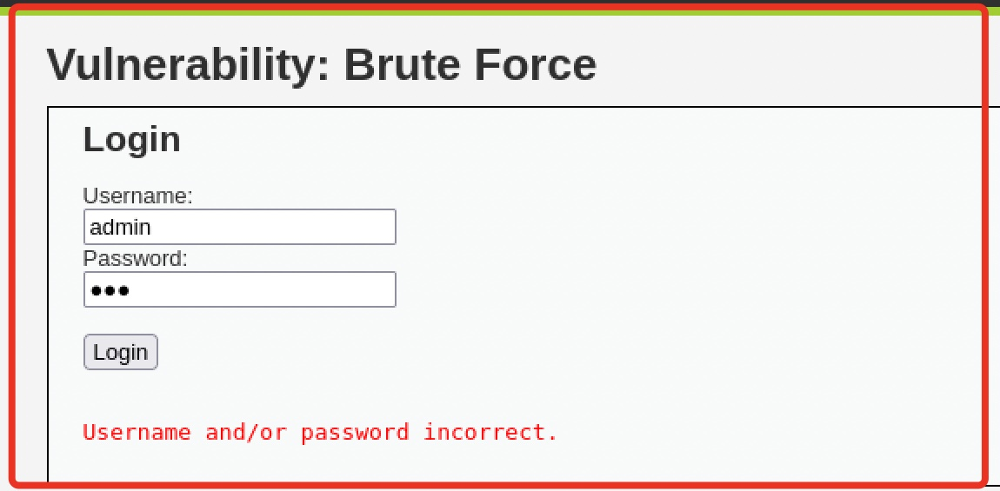
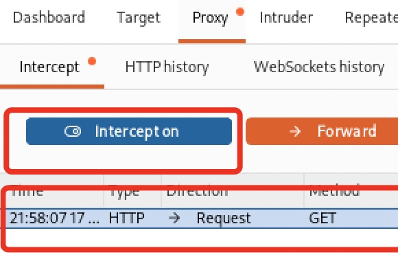
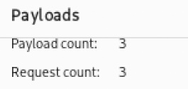

# DVWA Brute Force Lab

## Objective

Analyze why a weak password can compromise an administrative account when an application accepts repeated login attempts. Use the captured HTTP request and the application's response text to distinguish a rejected login from a successful one, then map the findings to defensive controls.

## Environment

| Component | Role in the lab |
| --- | --- |
| Kali Linux VM | Workstation for browser and HTTP traffic analysis |
| Damn Vulnerable Web Application (DVWA) | Deliberately vulnerable training application |
| DVWA security level | Low |
| Burp Suite Community Edition 2026.10.1 | HTTP request capture and response review |

The exercise covered DVWA's Brute Force module in a virtual lab. The tool version, security level, and results below are recorded from the lab notes.

## HTTP request observation

Burp Proxy captured the form submission as an HTTP **GET** request. The form sent the username and password in the URL query string. That puts credentials in a location that browser history, access logs, and monitoring tools can retain. The session cookie in the request represented the browser's existing DVWA session. The content returned by the Brute Force module indicated whether the separate credential check had succeeded.

## Results

The lab notes report that weak-password trials against the `admin` account produced both rejected and accepted responses. The response review used a failure-text match to distinguish rejected attempts. A missing failure marker alone is ambiguous because a redirect, expired session, or error page can also omit it. The positive evidence was the success text recorded in the response body.

| Outcome | Evidence |
| --- | --- |
| Rejected attempts | The response body matched DVWA's login failure text. |
| Accepted attempt | The response body displayed `Welcome to the password protected area admin`. |

The recorded success shows that the module accepted a weak password under the tested conditions. The exercise did not measure a lockout threshold or assess the other DVWA security levels.

## Mitigations

| Finding | Control | How to verify the control |
| --- | --- | --- |
| A weak password was sufficient to access the protected area. | Remove default credentials, block common and compromised passwords, and require MFA for administrative accounts. | Verify that a new administrator cannot enroll with a blocked password and that a valid password still requires MFA. |
| Repeated failures were accepted during the exercise. | Rate-limit login attempts per account and use source and service-wide limits to supplement account-level controls. Add progressive delays and monitor for abuse. | Use authentication tests to confirm that failures accumulate toward the configured threshold and that recovery works after the delay. |
| Credentials were sent in the URL. | Send credentials in a POST body over HTTPS. Exclude passwords, session tokens, and authorization headers from logging and telemetry. | Inspect a test request and its corresponding logs to confirm that credentials stay out of the URL and logging pipeline. |
| Response text revealed the outcome. | Return consistent errors for invalid usernames and passwords. Record useful failure details in server-side security logs. | Compare invalid-user and invalid-password responses for consistent status, body, and timing. Confirm that failed logins still generate audit events. |

## What I learned

- Trace an authentication form to the underlying HTTP method and identify where credentials and session data appear.
- Use a positive response marker to confirm authentication when the absence of a failure message could have several explanations.
- Treat password strength, MFA, rate limiting, and secure request handling as separate controls, each with a testable purpose.

## Evidence

DVWA rejected the login and displayed `Username and/or password incorrect.`

Burp Proxy captured the form submission as an HTTP GET request.

Burp recorded three configured requests for the lab run.

The failure text used when reviewing rejected responses.

